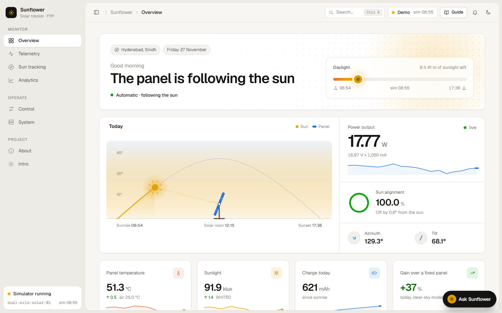
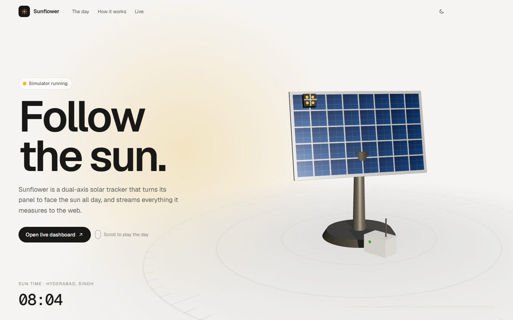
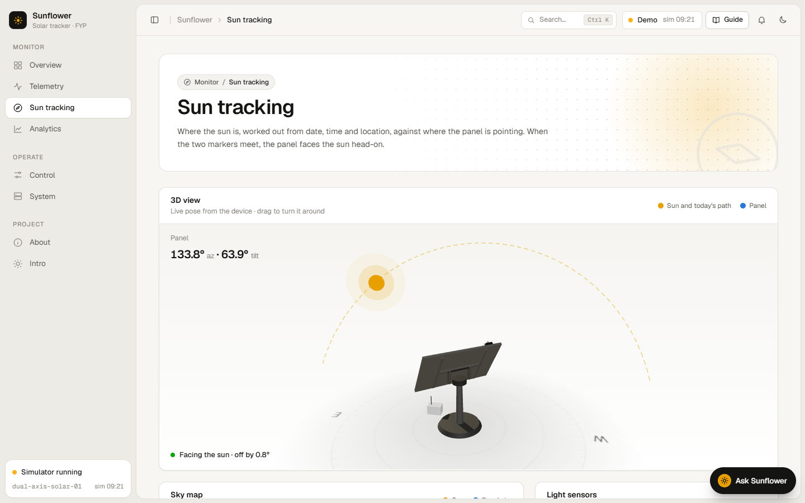
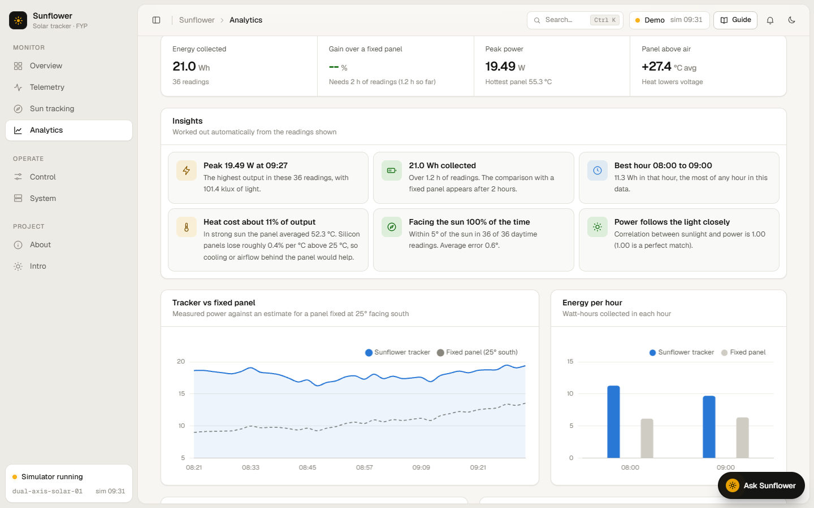
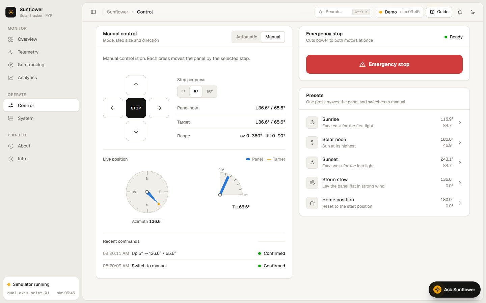
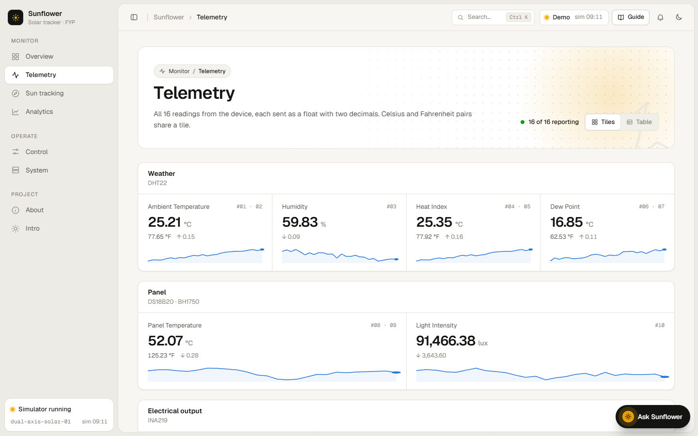
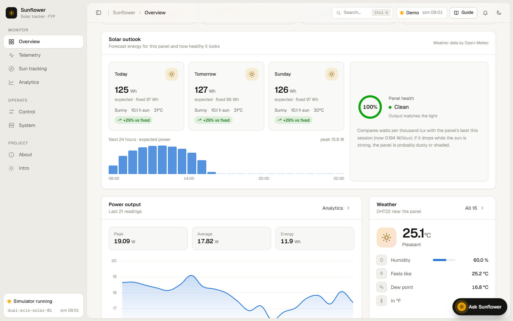
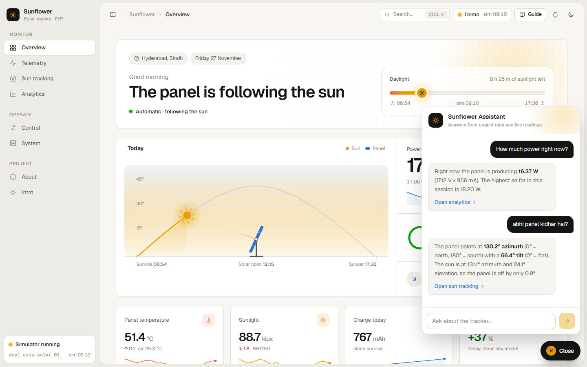
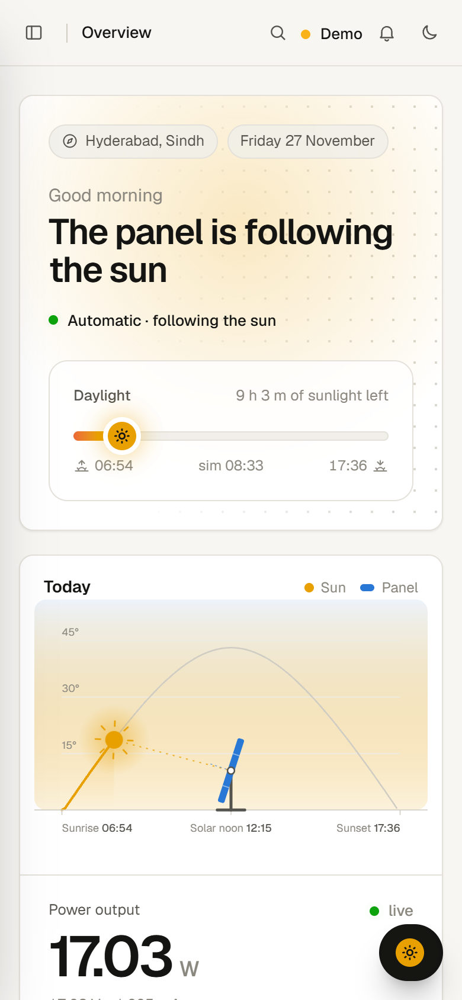
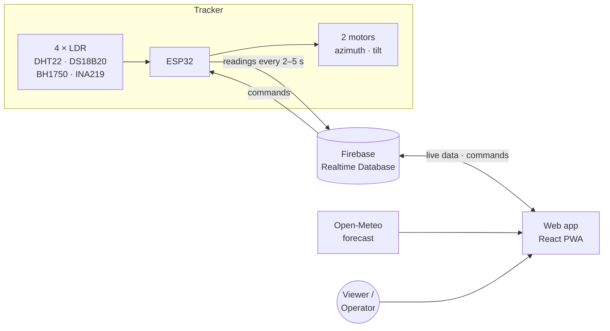

<div align="center">

# ☀️ SUNFLOWER

### An IoT-Integrated Intelligent Dual-Axis Solar Tracker

A solar panel that turns on two axes to follow the sun all day, connected to a real-time web platform to monitor, analyse and control it from anywhere.

[](https://sunflower-solar-tracker.web.app)




[Overview](#overview) · [Features](#features) · [Architecture](#system-architecture) · [How it was built](#how-it-was-built) · [Getting started](#getting-started) · [Hardware](#hardware) · [Roadmap](#roadmap)

</div>

---

## Overview

SUNFLOWER combines embedded hardware, a cloud backend and a modern web application into one complete IoT system.

- **The tracker** is a solar panel on a dual-axis mount. Four light sensors tell an ESP32 microcontroller where the sun is, and two motors keep the panel pointed at it.
- **The cloud** (Firebase Realtime Database) receives the tracker's readings every few seconds and carries commands back to it.
- **The web application** shows every reading live, explains what the tracker is doing, analyses its performance and lets an authorised operator control it remotely. It installs on any phone or computer as an app.

### The problem

A fixed solar panel faces the sun directly for only a short part of the day. In the morning and evening, and as the seasons change, sunlight reaches it at a steep angle and much of the available energy is lost.

### The solution

SUNFLOWER turns the panel on two axes, **azimuth** (east to west) and **tilt** (flat to upright), so it keeps facing the sun from sunrise to sunset. On a clear day this collects roughly **30–40% more direct sunlight** than the same panel fixed in place. For Hyderabad in late November the application's clear-sky model puts the gain at about **+37%**.

### Objectives

1. Track the sun automatically on two axes using a four-quadrant light sensor.
2. Measure 16 environmental and electrical parameters as precise floating-point values.
3. Stream every reading to the cloud in real time.
4. Provide a professional dashboard for monitoring, analysis and remote control.
5. Show, with numbers, how much better tracking performs than a fixed panel.

---

## Features

### Monitoring
- Live display of all **16 parameters**: ambient temperature (°C/°F), humidity, heat index (°C/°F), dew point (°C/°F), panel temperature (°C/°F), light intensity, shunt voltage, bus voltage, current, load voltage, power and capacity
- **Real-time 3D model** of the tracker, driven by live data, with the sun's path for the day
- Sky map, side view and a **four-quadrant LDR matrix** that shows why the panel is moving
- Device, Wi-Fi and cloud health, with automatic **offline detection** after 60 seconds

### Control
- **Automatic** (sensor tracking) and **Manual** modes
- Jog controls with **1° / 5° / 15°** steps, live position dials and per-command confirmation
- **Emergency stop** that cuts both motors at once
- Five presets: **Sunrise, Solar Noon, Sunset, Storm Stow, Home**, calculated for the current date
- Role-based access: anyone can watch, only signed-in operators can move the panel

### Analytics
- **Tracker vs fixed panel** comparison with the percentage gain
- Energy per hour, power, light and temperature charts
- **Automatic insights** in plain language: peak output, best hour, heat losses, tracking accuracy, light-to-power correlation
- Export to **Excel (CSV)** or **JSON**, and a one-click printable **report**

### Smart features
- **Sunflower Assistant**: a chat that answers in English or Roman Urdu from project knowledge and live readings
- **Guided tour** that explains every screen on the first visit
- **Solar forecast** for three days and the next 24 hours, from free Open-Meteo data
- **Panel health** score with a cleaning alert when output drops relative to the light
- **Smart alerts** for offline device, emergency stop, overheating, dust, missing readings and tracking errors, with sound, vibration and phone/desktop notifications
- Cinematic **intro page** where scrolling plays a full day as the 3D panel follows the sun
- Command palette (`Ctrl + K`), collapsible sidebar (`Ctrl + B`), light and dark themes
- **Installable app (PWA)** and a **demo mode** that runs the whole system without hardware

---

## Screenshots

| Intro | Sun tracking (3D) |
| --- | --- |
|  |  |
| **Analytics and insights** | **Control console** |
|  |  |
| **Telemetry** | **Solar outlook and panel health** |
|  |  |
| **Sunflower Assistant** | **On a phone** |
|  |  |

---

## System architecture



The tracker and the web application never talk to each other directly. Both connect to the same Firebase project, which acts as the bridge:

| Path | Written by | Read by | Contents |
| --- | --- | --- | --- |
| `devices/<id>/live` | ESP32, every 2–5 s | Web app | The latest reading |
| `devices/<id>/history` | ESP32, every 30 s | Web app | Readings for charts and export |
| `devices/<id>/control` | Web app (operator) | ESP32 | Mode, target angles, emergency stop |

### Data format

Each reading is a single JSON record. All 16 telemetry values are floats.

```json
{
  "device_id": "dual-axis-solar-01",
  "mode": "auto",
  "azimuth_deg": 180.0,
  "elevation_deg": 44.5,
  "telemetry": {
    "ambient_temp_c": 32.45, "ambient_temp_f": 90.41,
    "humidity_pct": 54.20,
    "heat_index_c": 35.10,   "heat_index_f": 95.18,
    "dew_point_c": 21.80,    "dew_point_f": 71.24,
    "panel_temp_c": 44.60,   "panel_temp_f": 112.28,
    "light_intensity_lux": 84500.50,
    "shunt_voltage_mv": 125.07,
    "bus_voltage_v": 18.25,
    "current_ma": 1250.75,
    "load_voltage_v": 18.38,
    "power_mw": 22826.19,
    "capacity_mah": 4520.30
  },
  "ldr_sensors": { "north": 88, "south": 85, "east": 64, "west": 89 },
  "ts": 1764150000,
  "rssi_dbm": -58,
  "estop": false,
  "last_cmd_id": 1764149990123
}
```

The full contract for the hardware is in [`docs/HARDWARE_HANDOVER.md`](docs/HARDWARE_HANDOVER.md).

### Security

Firebase security rules ([`database.rules.json`](database.rules.json)) enforce role-based access:

| Who | Can | Cannot |
| --- | --- | --- |
| Anyone with the link | Read live readings and history | Write anything, read commands |
| **Device** account | Write readings, read commands | Send commands |
| **Operator** role | Send and read commands | Write readings |
| A self-registered account with no role | Nothing beyond public reads | Control the panel or grant itself a role |

- Roles live in a `roles/<uid>` node that only the Firebase console or CLI can write.
- Readings are validated (numbers where numbers belong, angles and LDR values in range); commands are strictly validated and unknown fields are rejected.
- Secrets stay out of the repository: `secrets.h` and `.env` files are ignored, and the fake device reads its password from the environment.
- The rules are covered by 25 automated checks against the Firebase emulator: `npm run test:rules` (needs Java 21).

---

## How it was built

### Technology choices

| Layer | Choice | Why |
| --- | --- | --- |
| Interface | **React 19 + Vite** | Fast, component-based, code-split per page |
| Styling | **Tailwind CSS 4** with design tokens | One system for light and dark themes |
| Real-time backend | **Firebase Realtime Database** | Pushes every change to the browser instantly, with auth and rules, on a free plan |
| Charts | **Chart.js** | Lightweight, accessible line and bar charts |
| 3D and motion | **Three.js (react-three-fiber), GSAP, Lenis** | Live 3D tracker, scroll-driven intro, smooth animation |
| Forecast | **Open-Meteo** | Free solar-irradiance forecast, no API key |
| Firmware | **ESP32 + Arduino** | Wi-Fi built in, enough analog inputs for four LDRs |
| Hosting | **Firebase Hosting** | Free HTTPS hosting with one-command deploys |

### Algorithms

**Sun tracking (on the ESP32).** The controller compares opposite light sensors: west minus east drives the azimuth motor, north minus south drives the tilt motor. If a difference exceeds a **5% deadband**, that motor takes one step toward the brighter side; smaller differences are ignored so the panel does not jitter.

**Sun position (in the app).** The sun's azimuth and elevation are calculated for the site's latitude and longitude from the solar declination, the equation of time and the hour angle. This gives sunrise, solar noon and sunset, the sun's path for the day and the presets, and lets the app measure how far the panel is from the sun.

**Tracker vs fixed panel.** For each reading the app knows the sun's position and the panel's angle. It estimates what a panel fixed at the site latitude (25°) facing south would produce from the ratio of the two angles of incidence, and integrates both over time to report energy and percentage gain. A separate clear-sky model (Meinel air-mass formula) gives the expected gain for the whole day.

**Panel health.** Output is measured as watts per thousand lux in strong light and compared with the panel's best in the same session. A sustained drop below 75% points to dust, shading or a fault and raises a cleaning alert.

**Insights.** Plain-language findings are derived from the readings: peak output and its time, the best hour, the heat loss (about 0.4% per °C above 25 °C), the share of time the panel was within 5° of the sun, and the correlation between light and power.

**Assistant.** A rule-based engine matches each question, in English or Roman Urdu, to a set of topics and fills the answer with live values. It needs no paid AI service and cannot invent answers.

### Simulator

A built-in simulator generates physically consistent readings that follow the real sun for the configured site, including heat index, dew point, panel heating and shunt voltage. It powers **demo mode** and the `npm run fake-device` tool, so the entire system can be developed, tested and demonstrated before the hardware is ready.

---

## Getting started

**Requirements:** Node.js 20 or newer and a free Firebase project.

```bash
git clone https://github.com/msohaiilkz/Solar-Tracker.git
cd Solar-Tracker
npm install
npm run dev          # http://localhost:5173
```

Without Firebase settings the app runs on the simulator. Add `?demo` to any URL to force demo mode.

### Connect a Firebase project

1. Create a Firebase project with **Realtime Database** (locked mode) and **Email/Password** sign-in.
2. Publish the rules from [`database.rules.json`](database.rules.json).
3. Register a web app and paste its config into [`src/config.js`](src/config.js).
4. Create two users: an **operator** for the dashboard and a **device** for the ESP32.

Full guide: [`docs/FIREBASE_SETUP.md`](docs/FIREBASE_SETUP.md)

### Test without hardware

```bash
# PowerShell
$env:DEVICE_EMAIL="device@example.com"; $env:DEVICE_PASSWORD="<device password>"; npm run fake-device
```

The fake device signs in, writes readings to Firebase and obeys commands exactly as the ESP32 would.

### Configuration

Everything that changes between installations lives in [`src/config.js`](src/config.js):

| Key | Purpose |
| --- | --- |
| `firebase` | Firebase web app settings |
| `deviceId` | Device path in the database |
| `site` | Location (name, latitude, longitude, time zone) for sun calculations and the forecast |
| `limits` | Mechanical range for azimuth and tilt |
| `deadband` | LDR difference ignored by the tracker (%) |
| `panel.ratedW` | Panel rating, used for the energy forecast |
| `alerts` | Thresholds for overheating, panel health and tracking error |
| `offlineAfterSec` | Seconds without data before the device is shown offline |

### Deploy

```bash
npm install -g firebase-tools
firebase login
npm run deploy       # builds and publishes hosting and database rules
```

### Scripts

| Command | What it does |
| --- | --- |
| `npm run dev` | Start the development server |
| `npm run build` | Production build into `dist/` |
| `npm run preview` | Serve the production build locally |
| `npm run fake-device` | Simulated ESP32 that writes to Firebase |
| `npm run test:rules` | Check the security rules on the Firebase emulator |
| `npm run deploy` | Build and publish to Firebase Hosting |

---

## Hardware

| Component | Role |
| --- | --- |
| ESP32 | Controller and Wi-Fi |
| 4 × LDR (four-quadrant) | Sun direction |
| 2 × servo / motor | Azimuth and tilt |
| DHT22 | Air temperature and humidity |
| DS18B20 | Panel temperature |
| BH1750 | Light intensity |
| INA219 | Voltage, current and power |

The reference firmware in [`firmware/sunflower_esp32`](firmware/sunflower_esp32) reads all sensors, runs the tracking loop, uploads JSON over HTTPS, polls for commands, handles the emergency stop and synchronises time over NTP. Copy `secrets.example.h` to `secrets.h`, enter the Wi-Fi and Firebase details, set the pins and upload.

---

## Project structure

```
├── src/
│   ├── config.js               single place for all settings
│   ├── App.jsx                 routes, providers, code-splitting
│   ├── components/
│   │   ├── Shell.jsx           sidebar, top bar, command palette, tour, assistant
│   │   ├── Landing.jsx         cinematic intro (GSAP, ScrollTrigger, Lenis)
│   │   ├── Overview.jsx        main dashboard
│   │   ├── Telemetry.jsx       16 parameters
│   │   ├── Tracking.jsx        3D view, sky map, LDR matrix
│   │   ├── Control.jsx         modes, jog controls, presets, emergency stop
│   │   ├── Analytics.jsx       charts, insights, export, report
│   │   ├── System.jsx · About.jsx · Forecast.jsx · Assistant.jsx · Tour.jsx
│   │   └── three/TrackerScene.jsx   3D tracker (react-three-fiber)
│   ├── hooks/                  telemetry store, theme, alerts
│   └── lib/                    data source, simulator, sun position, energy model,
│                               forecast, panel health, insights, assistant
├── firmware/sunflower_esp32/   ESP32 reference firmware
├── database.rules.json         Firebase security rules
├── docs/                       setup guide, hardware handover, project guide, screenshots
├── public/                     icons, PWA manifest, service worker
└── tools/                      fake device, icon generator
```

---

## Roadmap

- [x] Real-time dashboard for all 16 parameters
- [x] Automatic and manual control with emergency stop and presets
- [x] 3D visualisation and scroll-driven intro
- [x] Analytics, insights, export and printable report
- [x] Assistant, guided tour, solar forecast, panel health and smart alerts
- [x] Installable app and demo mode
- [ ] Field testing on the assembled tracker
- [ ] Wi-Fi setup by QR code
- [ ] Alerts on Telegram or WhatsApp when the app is closed
- [ ] Full Urdu interface
- [ ] Several trackers in one account
- [ ] Savings shown in rupees
- [ ] Automatic flat stowing before storms, and hybrid tracking under cloud

---

<div align="center">

**Developed by Muhammad Sohail**
<br>
Full Stack Developer

</div>
